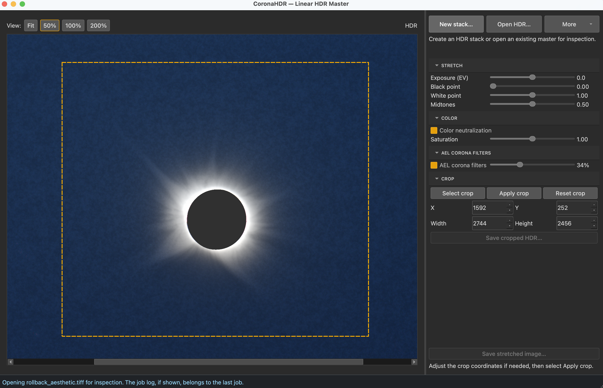

# CoronaHDR

CoronaHDR is a desktop application for creating linear HDR masters from bracketed total-solar-eclipse photographs. It supports scientific and aesthetic stacking, optional persistent hot-pixel detection, and an image preview with stretch, crop and quick AEL-based corona filters.

**Author:** Francisco Bitto. CoronaHDR was developed using [Agentic Eclipse Library (AEL)](https://github.com/PeterWar/Agentic-Eclipse-Library) by Pere Guerra Serra.

> **Recommended workflow:** For eclipse calibration, stacking and coronal filtering, use [Agentic Eclipse Library](https://github.com/PeterWar/Agentic-Eclipse-Library). It provides a broader agent-guided workflow. CoronaHDR is an alternative desktop stacking tool and its AEL filter preview is a quick approximation. For further visual processing of a linear master, try Francisco Bitto’s [Eclipse Image Processor](https://github.com/fbitto/Eclipse-Image-Processor).



## Requirements and installation

- macOS has been tested. Linux has not been qualified; Windows is not currently supported because job locking uses Unix APIs.
- Python **3.14.8**, [uv](https://docs.astral.sh/uv/getting-started/installation/) and enough free disk space. Temporary processing can require tens or hundreds of GB; an external drive is recommended.
- Automatic folder processing supports one Canon CR2/CR3 or Nikon NEF/NRW acquisition. A file extension alone does not guarantee successful calibration or alignment.

Clone the repository, open a terminal in its folder, and run:

```bash
uv sync --locked --python 3.14.8
uv run coronahdr
```

If you do not already have Python 3.14.8, follow the [uv Python installation instructions](https://docs.astral.sh/uv/guides/install-python/). For command-line help, run `uv run coronahdr --help`.

## Quick start

1. Select **New stack…** and choose the original **Lights** folder. Add matching bias, dark, flat and dark-flat folders if available.
2. Choose a **temporary files folder** with ample space. The default may be an operating-system temporary location; choose a persistent external folder if you want to resume or inspect the job later. Final outputs default to `HDR_output` beside the Lights folder.
3. Choose a base name, FITS and/or TIFF, and **Scientific**, **Aesthetic** or **Both**. Optional persistent hot-pixel detection is available for supported Bayer RAW inputs.
4. Select an alignment method, start processing, and review frame selections and any prompts. Conservative alignment is shift-only. The AEL-style visual option estimates rotation for aesthetic processing and is experimental; it does not correct lens distortion or establish scientific alignment.
5. Open the result folder for the linear master, settings JSON and job log. Reports, masks and preparation files remain in temporary storage. Use **More → Clean up temporary data** to review old app jobs before deleting their temporary data.
6. Use **Open HDR…** to inspect a completed FITS or TIFF. The right-hand sections adjust the preview; **Save stretched image…** creates a separate nonlinear image. **Crop → Save cropped HDR…** creates a separate linear master when the necessary geometry metadata is present.

The status bar identifies the current step. Its progress bar counts the current activity where possible; it is not an overall time estimate. **Show log** reveals recent messages; **View log** opens the complete log.

## Scientific and aesthetic outputs

**Scientific** stacking applies strict relative-radiometry checks and excludes incompatible samples. Its values are relative camera response, not absolute calibrated radiance. **Aesthetic** stacking uses empirical brightness/background matching and smooth blending for visual use; those adjustments can change large-scale brightness and color. **Both** produces separate masters.

Persistent hot-pixel detection is optional and does not require calibration frames. It looks for recurring isolated detector-fixed outliers in repeated exposure tiers and requires measured image displacement. Scientific mode masks confirmed defects; aesthetic mode can interpolate eligible samples. This is not a substitute for dark, bias or flat calibration, and undetected defects may remain. Missing calibration, changing sky conditions, registration errors and lunar motion can all limit a result; inspect the warnings, frame selection and masks.

## Preview and export

The preview adjustments do not alter a linear master. The **AEL CORONA FILTERS** checkbox combines NRGF, edge-aware WOW and ACHF for quick inspection. New jobs save filter coverage and lunar geometry in the settings JSON, bound to the final image by its hash; keep that JSON with the master. If the original information is unavailable, the app offers an approximate preview after you review the estimated lunar edge and motion margin. The margin defaults to zero when unknown; increase it if needed to protect against lunar motion. Finite pixels are then treated as usable, but their geometric coverage is unverified. Fit and 50% use an approximate filtered preview. At 100% and 200%, the preview shows unfiltered native detail; drag to pan at 50%, 100% and 200%. A nonlinear export applies enabled filters at full resolution. Missing pixels remain identified in a separate validity mask; the app asks before interpolating small eligible gaps.

A saved settings JSON can refill the folder dialog for review; it does not start processing automatically. Existing output files are never intentionally overwritten.

## Credits and license

CoronaHDR is licensed under the [MIT License](LICENSE). The AEL filter implementation includes code by Pere Guerra Serra under the [AEL MIT notice](src/coronahdr/_ael_filters/LICENSE); the AEL registration implementation also retains its copyright and permission notice in the source. Preview color neutralization draws on Eclipse Image Processor and eclipsetools; their notices are in [third-party licenses](docs/third-party/).

Research and inspiration include [eclipsetools](https://github.com/naavis/eclipsetools), [EclipseForgeHDR](https://github.com/naugustin77/EclipseForgeHDR), [Umbra](https://github.com/LudoRey/umbra), [Gava’s thesis](https://matheo.uliege.be/handle/2268.2/4511) and the [Cloudy Nights eclipse-processing discussion](https://www.cloudynights.com/forums/topic/888126-solar-eclipse-image-processing-achf-fnrgf/). Inspiration does not imply that code from each project was incorporated or that its authors validated CoronaHDR.

Direct dependencies include NumPy, SciPy, scikit-image, Astropy, tifffile, rawpy/LibRaw, OpenCV and PySide6/Qt. They and their dependencies have their own licenses. The app’s **More → About CoronaHDR** window lists the available package-license information and project links.
